<div align="center">


<br>

[](https://go.dev)
[](#tech-stack)
[](#tech-stack)
[](#security-model)
[](#roadmap)

**Push to a Git repo. Get a live HTTPS URL. Safely.**<br>
ForgeOps builds every commit in a gVisor sandbox, deploys it as an immutable container behind a dynamic router,<br>
and rolls back with a single registry write. Written in Go, self-hostable with Docker.

[Architecture](#architecture) · [Today](#what-runs-today) · [Push to live](#from-git-push-to-a-live-url) · [Security model](#security-model) · [Routing](#routing-and-rollback) · [Build cache](#build-cache) · [Logs](#live-logs) · [Roadmap](#roadmap) · [Getting started](#getting-started)

</div>

---

> [!IMPORTANT]
> **ForgeOps has finished Phase 0 of its 14 phases (0–13).** The three services boot, connect to Postgres and Redis, serve health probes and shut down cleanly. Nothing builds or deploys yet.
> The diagrams show the target design, and every feature names the phase that delivers it. This README is updated as phases land, and it never presents something that doesn't run yet as if it did.

## Why ForgeOps

Platforms like Vercel, Render and Heroku make deployment look like one step: `git push`, wait a few seconds, open the URL. Underneath, that step is a distributed system with a hard security problem at its centre. **The platform runs code written by strangers, on its own machines, on every push.**

Most "mini-Heroku" projects stop at "it deploys". ForgeOps is built around the harder questions:

- **What can a malicious build do?** A `postinstall` script can try to read the host's files, call the control plane's database, reach another customer's container, fork-bomb the machine or eat all its memory. ForgeOps runs builds under [gVisor](https://gvisor.dev), where a user-space kernel answers the build's system calls, and it ships a hostile test repository that tries each of those attacks.
- **How do you deploy without dropping traffic?** Deployments are immutable. The router reads a registry from Redis and gets pub/sub invalidations, so a new deploy or a rollback changes one entry and the proxy never restarts.
- **How do you avoid paying for the same `node_modules` a thousand times?** Build layers are content-addressed with SHA-256 and reference-counted, using the dedup engine from [HashVault](https://github.com/AnkitSinha0/HashVault), so identical layers across all tenants are stored once.

## Highlights

| Capability | What it means | Phase |
|---|---|:-:|
| **Health and graceful shutdown** | Liveness and readiness are separate probes; SIGTERM drains in-flight requests | 0 (done) |
| **Tenant-scoped data layer** | Every query is scoped by tenant; secrets are encrypted at rest | 1–2 |
| **Signed webhooks** | GitHub `X-Hub-Signature-256` HMAC is verified before anything is queued; `go-git` clones the exact commit | 3 |
| **Build queue** | Redis-backed queue with atomic claims; per-build timeout and memory limit | 4 |
| **Dynamic routing + auto TLS** | `httputil.ReverseProxy` driven by a Redis registry, certificates from ACME | 5 |
| **Instant rollback** | Immutable deployments; rollback re-points the registry, with no rebuild | 5 |
| **gVisor isolation** | No host filesystem, no route to the control plane, cgroup limits on memory, CPU and PIDs | 6 |
| **Content-addressed build cache** | SHA-256 layer dedup with reference counting, reused from HashVault | 7 |
| **Live logs** | Server-Sent Events fed by Redis pub/sub, so any replica can serve any viewer | 8 |
| **Quotas and custom domains** | Per-tenant resource quotas; DNS TXT verification for custom domains | 9 |
| **Observability** | Prometheus metrics on every service, Grafana dashboards in the compose stack | 10 |
| **Measured reliability** | Load, chaos and escape-attempt harnesses; `make loadtest` and `make chaostest` | 11 |

## Architecture


ForgeOps is a **modular monolith split into three processes**. They share one repository and one set of `internal/` packages, but each has a different job, different privileges and a different failure mode.

| Process | Listens on | Job | Talks to | Holds |
|---|---|---|---|---|
| `controlplane` | `:8080` | REST API, GitHub webhooks, projects, deployments, env vars, SSE log streams | Postgres, Redis | DB credentials, encryption key for secrets |
| `executor` | ops `:8081` | Claims build jobs, clones the commit, builds it in a sandbox, records layers | Postgres, Redis, MinIO, Docker | DB credentials, Docker socket |
| `router` | `:8000` (`:443` in production), ops `:8082` | Terminates TLS, maps `Host` to a deployment, proxies the request | **Redis only** | Nothing that reaches tenant data |

**Why three processes and not one?** The router faces the internet, the executor runs untrusted code, and the control plane holds the data. Putting them in one process would give the internet-facing code the database password and the Docker socket. Splitting them means each process only gets the credentials its own job needs.

**Why not microservices?** Three processes with shared packages give the isolation benefits without a service mesh, versioned APIs between services, or distributed transactions. Any `internal/` package can move into its own service later, if load ever requires it.

## What runs today


Phase 0 is the foundation every later phase stands on. The behaviour in this diagram was verified by hand, and the probe output in it is the actual captured output.

- **Liveness never checks dependencies.** If `/healthz` pinged Postgres, one database blip would make an orchestrator restart every healthy service at once. Only `/readyz` checks dependencies, and a 503 just takes the instance out of rotation until the dependency comes back.
- **The router has no database credentials.** It is the only internet-facing process, so it gets Redis and nothing else. Phase 5 puts everything it needs (host to backend) into the Redis registry.
- **Router probes live on a separate ops port.** Every path on the proxy port belongs to a tenant app. A router-owned `/healthz` there would shadow a tenant's own `/healthz` and put the probe on the public internet.
- **Startup tells the truth.** Ports are bound synchronously, so "listening" is logged only once it's true. The first database connection is bounded at 5 s, so an unreachable host fails the boot instead of hanging it.

## From git push to a live URL


The control plane never builds anything, and the executor never serves an API. The queue sits between them, so a slow build can't block a webhook, and a crashed executor doesn't lose the job.

### Webhook handling

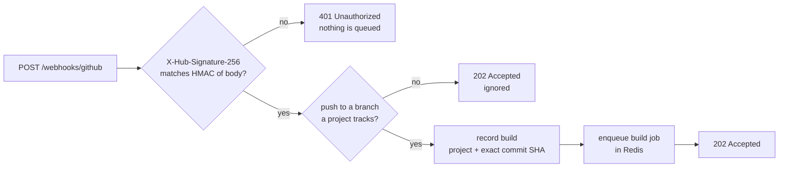

The signature is checked against the **raw request body** with a constant-time compare, before any JSON is parsed. An unsigned request never reaches the database.

### Deployment lifecycle

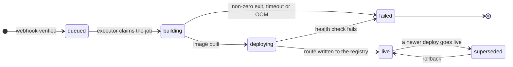

A deployment is never changed after it is built. "Rollback" doesn't rebuild anything: it points the route back at an older deployment.

## Security model


This is the centrepiece of the project (Phase 6). The threat model is simple: **every build is hostile**. A dependency's install script is arbitrary code, and ForgeOps runs it on every push.

| Layer | What it stops | Mechanism |
|---|---|---|
| gVisor Sentry | Host-kernel attack surface | Builds run under `runsc`. A user-space kernel implements the system calls, so the build never talks to the host kernel directly |
| Filesystem | Reading host files or the Docker socket | No host mounts. File access goes through gVisor's gofer, which only sees the build's own root filesystem |
| Network policy | Reaching Postgres, Redis, the API, cloud metadata or other tenants | Egress to internal ranges is denied, and there is no east-west traffic between sandboxes |
| cgroup limits | Fork bombs, memory exhaustion, CPU hogging | `pids.max`, `memory.max` (OOM-kill, exit 137), `cpu.max` |
| Timeout | Builds that never finish | Killed at the deadline, with the status recorded |

**Why gVisor and not Firecracker?** Firecracker microVMs are what AWS Lambda uses, and they give a stronger boundary. They also need microVM orchestration, a jailer, tap networking and image conversion, which is weeks of work before the first build runs. gVisor is an OCI runtime that drops in for `runc` and gives most of the isolation benefit for a fraction of that cost. It's the right first choice for this project. A Firecracker path for hot builds is a stretch goal, once everything else is solid.

> [!NOTE]
> The escape suite is **planned, not run**. When Phase 6 lands, this section will show the result of each attempt, including any that are only partly contained, and a list of what ForgeOps does *not* defend against.

## Routing and rollback


- **Hot path in memory.** The router answers `Host → backend` from a local map, so it doesn't make a Redis round trip on every request. Redis is the source of truth, and a pub/sub message tells every router replica to refresh.
- **No restarts.** A deploy or a rollback changes data, not configuration. The proxy process stays up and keeps its open connections.
- **Automatic TLS.** Certificates are issued per host through ACME (`autocert`), selected by SNI during the handshake.
- **Long-lived responses.** Tenant responses and SSE streams can't live under the 15 s `WriteTimeout` the Phase 0 servers use. The proxy lifts it per handler.

## Build cache


Two projects with the same `package-lock.json` produce the same `node_modules` layer, byte for byte. ForgeOps hashes every layer with SHA-256 and stores it under its digest, so the second copy costs one reference count, not another upload.

The engine comes from [HashVault](https://github.com/AnkitSinha0/HashVault), a content-addressed storage system with reference counting, which ForgeOps reuses here. Only the hashing, ref-count and storage-object pieces are extracted; HashVault itself isn't re-architected. Phase 7 publishes cold versus warm build times.

## Live logs


Logs only flow one way, so ForgeOps uses **Server-Sent Events** instead of WebSockets: plain HTTP, `text/event-stream`, flushed line by line with `http.Flusher`. Redis pub/sub sits between the executor and the API, so a viewer can be connected to any control-plane replica and still see every line.

## Data model

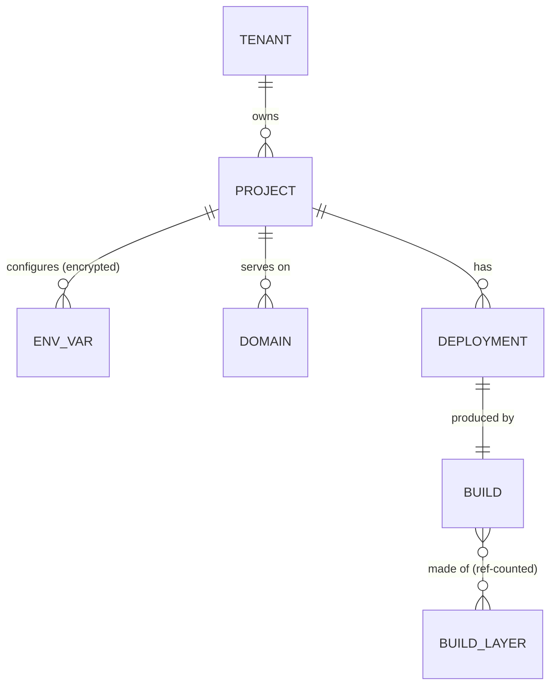

Phase 1 turns this into GORM models and repositories, and their fields are designed there. Every repository query is scoped by tenant, so one tenant can't read another tenant's rows, even if a handler has a bug.

## Testing and reliability

The README's headline numbers come from Phase 11. Until then, **there are no numbers here**. A fabricated benchmark is worse than none.

| Metric | How it's measured | Result |
|---|---|---|
| Build throughput | Go harness firing N concurrent deploys; queue wait at 5 / 20 / 50 | Phase 11 |
| Push-to-live latency | Small Node app, p50 and p99 | Phase 11 |
| Router throughput | k6 / vegeta across 100+ live deployments, sustained req/s and p99 | Phase 11 |
| Isolation | Hostile repo: every escape attempt from the security model | Phase 6 |
| Resource limits | A build asking for 10 GB dies at its quota; the host and other tenants are unaffected | Phase 11 |

Everything will be reproducible with `make loadtest` and `make chaostest`.

## Roadmap


Each phase ends with something runnable and a check that actually runs.

| # | Phase | Done when | Status |
|:-:|---|---|---|
| 0 | Foundation | Three services start, connect to infra, pass probes, drain on SIGTERM | **done** |
| 1 | Domain model and repositories | The schema migrates and every repository passes CRUD tests | next |
| 2 | Control plane API, auth, tenancy | Create a project, set env vars and list deployments with `curl`; cross-tenant reads fail | planned |
| 3 | Git integration | A push to a connected repo clones the exact commit; a bad signature gets a 401 | planned |
| 4 | Build executor | Push → build in a container → image; a build over its limit is killed cleanly | planned |
| 5 | Deploy, router, TLS | Push to main → live on HTTPS in seconds → one-click rollback | planned |
| 6 | **gVisor isolation** | Builds run under `runsc`; the hostile repo's escape attempts are all contained | planned |
| 7 | Build cache | Identical layers stored once; cold versus warm build times published | planned |
| 8 | Log streaming | A build log streams live to several viewers at once | planned |
| 9 | Quotas, custom domains, secrets | A tenant over quota is throttled; a custom domain is verified end to end | planned |
| 10 | Observability | Grafana shows every number this README claims | planned |
| 11 | Testing and reliability | `make loadtest` / `make chaostest` produce the table above | planned |
| 12 | Dashboard | Projects, deployments, live logs, rollback button | planned |
| 13 | Packaging and docs | A stranger can clone, self-host and demo it | planned |

Stretch goals: Firecracker for the build sandbox, a Kubernetes path with `client-go`, a Terraform self-deploy, and an optional CockroachDB compatibility pass.

## Getting started

### Requirements

| | |
|---|---|
| **Go** | 1.26.4 or newer |
| **Docker** | Docker Engine or Docker Desktop with Compose v2 |
| **make** | GNU make (on Windows: Git Bash, MSYS2 or WSL) |
| **Ports** | 8000, 8080–8082, 5433, 6380, 9010, 9011 |
| **For `make test`** | cgo and gcc, because the tests run with `-race` |

The compose ports are shifted by one from the defaults (`5433`, `6380`, `9010`), so ForgeOps can run next to another Postgres, Redis or MinIO on the same machine.

### Run it

These commands work today.

```bash
git clone https://github.com/AnkitSinha0/ForgeOps.git && cd ForgeOps
cp .env.example .env
make up                 # Postgres 17, Redis 7, MinIO; waits until all are healthy

make run-controlplane   # terminal 1
make run-executor       # terminal 2
make run-router         # terminal 3
```

```bash
curl -i localhost:8080/readyz    # 200 {"status":"ready","service":"controlplane","checks":{"postgres":"ok","redis":"ok"}}
curl -i localhost:8081/readyz    # 200, service "executor"
curl -i localhost:8082/readyz    # 200, only a "redis" check: the router has no database
curl -i localhost:8000/anything  # 404 no deployment is bound to this host
```

To see the liveness/readiness split for yourself:

```bash
docker compose -f deploy/docker-compose.yml stop redis
curl -i localhost:8082/healthz   # 200: the process is alive
curl -i localhost:8082/readyz    # 503: {"status":"not_ready",...,"checks":{"redis":"fail"}}
docker compose -f deploy/docker-compose.yml start redis
curl -i localhost:8082/readyz    # 200 again, with no service restart
```

Press Ctrl+C in a service's terminal to stop it gracefully. `make down` stops the infrastructure, and `make reset` deletes its volumes too.

### Make targets

| Target | What it does |
|---|---|
| `make up` / `down` / `reset` | Start the infrastructure / stop it / stop it and delete every row, key and object |
| `make logs` / `ps` | Follow the infrastructure logs / list its containers |
| `make run-controlplane` / `run-executor` / `run-router` | Run one service with `go run` |
| `make build` | Build all three binaries into `bin/` |
| `make test` / `vet` / `fmt` / `tidy` | Go tooling |

### Configuration

Every setting has a safe default in [`internal/config/config.go`](internal/config/config.go). Environment variables override `.env`, which overrides the defaults, and no config file is required, so a binary can start from any directory.

| Variable | Default | Used by |
|---|---|---|
| `APP_ENV` | `development` | all (`production` switches to JSON logs) |
| `APP_SHUTDOWN_TIMEOUT` | `15s` | all |
| `CONTROLPLANE_ADDR` | `:8080` | controlplane |
| `EXECUTOR_OPS_ADDR` | `:8081` | executor |
| `ROUTER_ADDR` / `ROUTER_OPS_ADDR` | `:8000` / `:8082` | router |
| `DATABASE_DSN` | *(required)* | controlplane, executor |
| `DATABASE_MAX_OPEN_CONNS` / `MAX_IDLE_CONNS` / `CONN_MAX_LIFETIME` | `25` / `10` / `5m` | controlplane, executor |
| `REDIS_ADDR` / `REDIS_PASSWORD` / `REDIS_DB` | `localhost:6380` / empty / `0` | all |

## Tech stack

| Concern | Choice | Why |
|---|---|---|
| Language | Go 1.26 | One language across API, worker and proxy; the container ecosystem (Docker, containerd, gVisor) is Go |
| HTTP | `chi` | Small, idiomatic, `net/http`-compatible; SSE and `http.Flusher` work with no adapter |
| State | PostgreSQL 17 + GORM | Relational data with tenancy constraints |
| Queue, registry, fan-out | Redis 7 (append-only file on) | One dependency for the build queue, router registry and log pub/sub; the AOF means a restart doesn't lose the queue |
| Object storage | MinIO through the S3 API (pinned `pgsty/minio`) | S3-compatible layer storage that runs locally; the official image is no longer published |
| Git | `go-github` + `go-git` | Webhooks and metadata, plus cloning without shelling out to `git` |
| Build sandbox | Docker SDK, then gVisor `runsc` | End-to-end with plain Docker first, then hardened isolation in Phase 6 |
| Proxy and TLS | `httputil.ReverseProxy` + `autocert` | A hand-built router, explainable down to the TLS handshake |
| Logging | `zap` | Structured logs tagged by service; no global logger |
| Metrics | Prometheus + Grafana | Phase 10 |
| Dashboard | React + Tailwind | Deliberately minimal (Phase 12) |

## Repository layout

```text
cmd/
  controlplane/        API server: webhooks, projects, deployments, SSE logs
  executor/            build worker
  router/              edge proxy + ops listener
internal/
  config/              Viper instance, defaults in code, env overrides
  database/            Postgres (GORM) and Redis clients with bounded pings
  health/              liveness vs readiness probes
  httpserver/          hardened timeouts, synchronous bind, graceful shutdown
pkg/
  logger/              zap logger tagged with the service name
deploy/                docker-compose.yml for local infrastructure
docs/diagrams/         build.py, the source of every diagram in this README
```

Planned packages, added in the phase that needs them: `models`, `repositories`, `services`, `handlers` (1–2), `git` (3), `queue`, `builder`, `sandbox` (4–6), `router` (5), `cache` (7), `logstream` (8), `observability` (10), plus `web/` (12) and `loadtest/` (11).

## Engineering approach

- **End to end before deep.** Push-to-deploy works with plain Docker (Phases 3–5) before isolation is hardened (Phase 6). The hardest unknown never blocks the happy path.
- **Failure paths are part of the feature.** Phase 0 was verified by breaking it: a port already taken, Redis stopped mid-run, an unreachable database, bad config, SIGTERM. Two bugs turned up that the happy path never showed.
- **Layering with sentinel errors.** Repository interfaces sit next to their GORM implementation, services return sentinel errors, handlers stay thin, and `var _ Interface = (*impl)(nil)` checks every implementation at compile time.
- **Decisions are written down.** [`DECISIONS.md`](DECISIONS.md) records each trade-off with the alternative considered and the condition that would flip it. [`RETRO.md`](RETRO.md) closes every phase.
- **Diagrams are code.** Every SVG here is generated by [`docs/diagrams/build.py`](docs/diagrams/build.py): plain SVG + CSS/SMIL, no JavaScript, and they respect `prefers-reduced-motion`.

### Key decisions so far

| Decision | Instead of | Because |
|---|---|---|
| The router connects to Redis only | Giving every service the same Postgres + Redis wiring | The internet-facing process should hold nothing that reaches tenant data; symmetry isn't a security property |
| Router probes on a separate ops port | A reserved path like `/__forgeops/healthz` on the proxy port | A reserved path still steals part of every tenant's URL space and puts the probe on the public internet |
| `/healthz` never checks dependencies | One `/health` that checks everything | A database blip would restart every healthy service at once |
| Config from env with defaults in code | A required `config.yaml` | Three containerised binaries start from any directory with zero mounted files |
| Pinned `pgsty/minio` | The official MinIO image | The official community image is no longer published; the S3 API keeps the store swappable |
| gVisor first, Firecracker as a stretch goal | Firecracker from day one | Most of the isolation benefit for a fraction of the integration cost |

## References

- [gVisor architecture guide](https://gvisor.dev/docs/architecture_guide/) · [Firecracker design](https://github.com/firecracker-microvm/firecracker/blob/main/docs/design.md)
- [GitHub: validating webhook deliveries](https://docs.github.com/en/webhooks/using-webhooks/validating-webhook-deliveries)
- [Kubernetes: liveness, readiness and startup probes](https://kubernetes.io/docs/concepts/configuration/liveness-readiness-startup-probes/)
- [Control Group v2](https://docs.kernel.org/admin-guide/cgroup-v2.html) · [`namespaces(7)`](https://man7.org/linux/man-pages/man7/namespaces.7.html)
- [RFC 8555: ACME](https://www.rfc-editor.org/rfc/rfc8555) · [HTML spec: Server-Sent Events](https://html.spec.whatwg.org/multipage/server-sent-events.html)

<div align="center">
<br>
<sub>Built in Go, one phase at a time.</sub>
</div>
